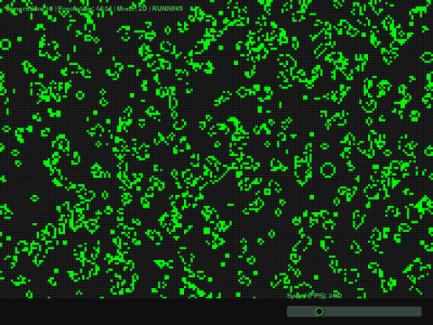
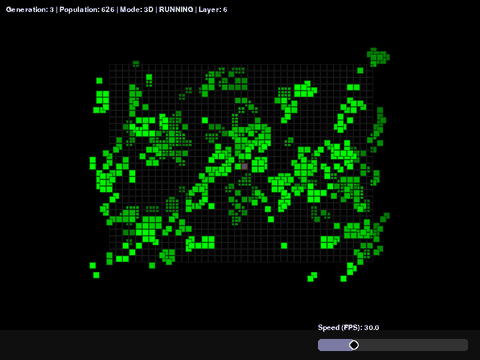
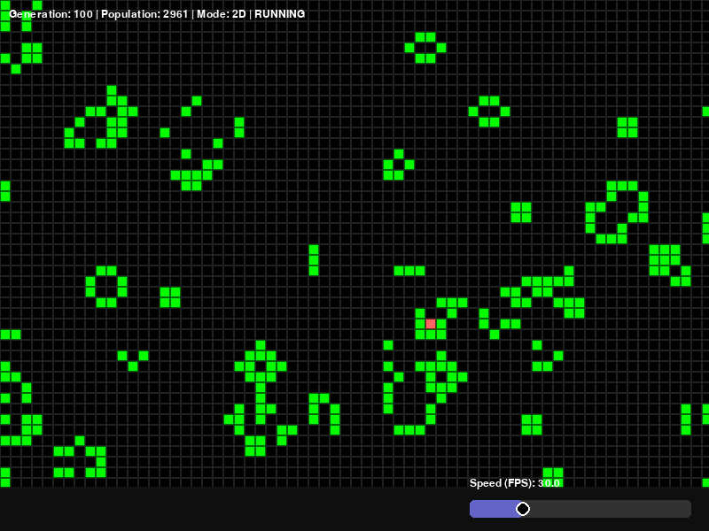

<h1 align="center">🧬 Conway's Game of Life</h1>

<p align="center">
  <b>Conway's cellular automaton in Pygame, with a pseudo-3D mode, a free camera and a Numba-compiled engine.</b><br>
  Paint cells, pan, zoom and rotate, and watch gliders, oscillators and chaos unfold on a toroidal board.
</p>

<p align="center">
  
  
  
  
  
</p>

<p align="center">
  
  
  <br><sub><b>Left:</b> classic 2D life (B3/S23) on the full 200×150 board. <b>Right:</b> 3D life (B5/S45), twelve layers seen from a rotating camera.</sub>
</p>

---

## ✨ Features

| | |
|---|---|
| 🟩 **Classic 2D** | Conway's rule **B3/S23**: born with 3 neighbours, survives with 2 or 3. |
| 🧊 **3D mode** | Experimental cubic life with rule **B5/S45** over 26 neighbours, drawn as stacked layers with depth fog. |
| 🍩 **Toroidal board** | Edges wrap around, so gliders fly off one side and come back from the other. |
| 🖌️ **Edit & paint** | Toggle single cells or paint whole strokes with the brush. In 3D, pick the layer you edit. |
| 🎥 **Free camera** | Pan, zoom to the cursor and rotate the 3D view. |
| ⏱️ **Speed control** | A slider from 1 to 120 generations per second, live generation and population counters. |
| ⚡ **Numba JIT** | Generation kernels compile to machine code: ~0.2 ms per 2D step and ~5 ms per 3D step on a 200×150×12 lattice. |
| 🤖 **AI hook** | `GameEngine.get_matrix_for_ai()` returns a window around the immortal red cell as `(x, y, z, alive)` tuples. |

<p align="center">
  
  <br><sub>Close-up: blinkers, beehives, loaves and the immortal <b>red cell</b> in the centre that the AI observes.</sub>
</p>

---

## 🚀 Getting started

**Requirements:** Python 3.10+, NumPy, Pygame, Numba.

```bash
git clone https://github.com/the-volador42/conways-game-of-life.git
cd conways-game-of-life
python -m venv .venv
```

Activate the virtual environment:

- **Windows:** `.venv\Scripts\activate`
- **macOS / Linux:** `source .venv/bin/activate`

Install and run:

```bash
python -m pip install -r requirements.txt
python src/main.py
```

> [!NOTE]
> The first launch takes a few seconds while Numba compiles the kernels. They are cached, so later launches start fast.

### 2D or 3D

Open [`src/main.py`](src/main.py) and set `MODE_3D`:

```python
MODE_3D = False  # classic 2D mode
MODE_3D = True   # 3D mode
```

---

## 🎮 Controls

| Control | Action |
|---|---|
| <kbd>Space</kbd> | Pause / resume (starts paused) |
| <kbd>R</kbd> | Randomize the field |
| <kbd>C</kbd> | Clear the field |
| <kbd>↑</kbd> / <kbd>↓</kbd> | Change the active layer (3D only) |
| Left click | Toggle a cell |
| <kbd>Shift</kbd> + right drag | Paint cells |
| Middle drag | Pan the camera |
| Mouse wheel | Zoom to the cursor |
| <kbd>Ctrl</kbd> + left drag | Rotate the camera (3D only) |
| Bottom slider | Simulation speed (FPS) |
| <kbd>Esc</kbd> | Exit |

---

## 🧩 Architecture

```text
conways-game-of-life/
├── requirements.txt
└── src/
    ├── main.py       # application loop and input handling
    ├── engine.py     # simulation rules (Numba kernels) and GameEngine
    ├── camera.py     # pan, zoom, rotation and grid ↔ screen projection
    ├── renderer.py   # grid, layers and statistics drawing
    └── ui.py         # slider widget and palette
```

- **Engine** owns the lattice `(depth, height, width)` and advances generations.
- **Camera** converts between grid and screen coordinates; in 3D each layer is shifted along the view angle.
- **Renderer** draws layers back to front with fog, without owning any simulation state.
- **UI** holds the reusable FPS slider and colours.
- **Main** wires everything together and handles Pygame events.

---

## 📄 License

Released under the [MIT License](LICENSE).
